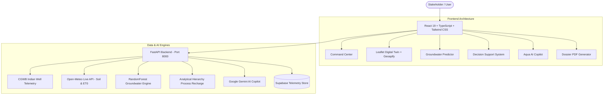

# AQUA — Aquifer Quantification & Understanding through AI
### *Understand Water. Predict Risk. Protect Tomorrow.*

[](LICENSE)
[](https://python.org)
[](https://fastapi.tiangolo.com)
[](https://react.dev)
[](https://www.typescriptlang.org)
[](https://tailwindcss.com)
[](https://leafletjs.com)

---

## 🌊 Overview

**AQUA** is a comprehensive, production-grade AI-powered **Watershed Digital Twin and Decision Support System (DSS)** designed for Indian hydrological basins. By combining verified groundwater telemetry from the **Central Ground Water Board (CGWB)**, live weather and evapotranspiration models from **Open-Meteo**, satellite surface-water monitoring (Sentinel-2 NDWI), and **Google Gemini AI**, AQUA enables proactive water stewardship for farmers, district administrators, and hydrologists.

---

## ✨ Key Capabilities & Modules

### 1. 🗺️ National Watershed Digital Twin (GIS)
- **Interactive Multi-Basin GIS**: Live geospatial mapping across Yamuna Basin, Haridwar, Ludhiana, Latur, Jaipur, Anantapur, and Thanjavur.
- **Vibrant Thematic Styling**:
  - 🌈 **Geoapify Vibrant Basemap**: Crisp high-contrast roads, water bodies, and topography.
  - 🛰️ **True Color Satellite**: Rivers in vivid blue, fertile land in brown, tree canopy in rich green.
  - 🔴 **Red Danger Zones**: Over-exploited aquifer drawdown cones with pulsing alerts.
  - 🟢 **Green Safe Zones**: Analytical Hierarchy Process (AHP) recharge suitability zones (>70).
  - 🟡 **Yellow Zones**: Moderate recharge potential.
  - 🔵 **Blue Hydro-Features**: Basins, rivers, canals, and DWLR telemetry observation stations.

### 2. 📈 Groundwater Depletion ML Predictor
- **Predictive Depth Modeling**: RandomForest Regression trained on precipitation lag, ET0, extraction rates, and geological specific yield.
- **Explainable AI (XAI)**: SHAP waterfall breakdown detailing the exact drivers of aquifer trends.
- **Uncertainty Quantification**: 95% Bayesian-style confidence bounds.

### 3. ⚠️ Multi-Indicator Drought Early Warning
- **Composite Drought Scoring**: Real-time fusion of:
  - **SPI-3** (Standardized Precipitation Index - 3 months)
  - **SMDI** (Soil Moisture Deficit Index via Open-Meteo live root-zone telemetry)
  - **GDI** (Groundwater Drought Index vs CGWB decadal normals)
- **Automated Village Alert Matrices**: Critical warning notifications for local panchayats and district collectors.

### 4. ⚖️ Multi-Stakeholder Decision Support System (DSS)
- **Role-Calibrated Interventions**:
  - **🌾 Farmers**: Micro-irrigation scheduling, alternate wetting & drying (AWD), low-water crop advisories.
  - **🏛️ District Officers**: Extraction quota enforcement, emergency water rationing, priority check dam tenders.
  - **🔬 Hydrologists / Researchers**: Specific yield recalculation, boundary flux validation, recharge basin zoning.

### 5. 🧪 What-If Hydrological Simulation Lab
- **Lumped Hydrological Balance**: Real-time simulation of precipitation, evapotranspiration, recharge, and pumping.
- **Interactive Policy Sliders**: Model the impact of climate anomalies, population shifts, and conservation investments on aquifer longevity.

### 6. 🌾 Crop-Aware Water Demand Planner
- **FAO-56 Dual Kc Methodology**: Crop coefficient curves for Wheat, Paddy, Sugarcane, Mustard, Cotton, and Gram.
- **Daily Soil Moisture Forecast**: 7-day root-zone depletion curves with optimal irrigation start windows.

### 7. 🤖 AQUA AI Copilot
- **Gemini-Powered Hydrological Reasoning**: Grounded in official Indian CGWB telemetry, IMD precipitation models, and regional hydrogeology.
- **Deterministic Rule-Engine Fallback**: Operates continuously even in offline or disconnected scenarios.

### 8. 📄 Automated Dossier PDF Generation
- **One-Click Comprehensive Export**: Generates printable stakeholder executive summaries with charts, telemetry tables, and DSS action items using `jsPDF` and `html2canvas`.

### 9. 🔐 Role-Based Access Control & Auth
- **Minimal, Elegant Login**: Email, password with toggle show/hide, remember me, and Google OAuth flow.
- **Dynamic User Personalization**: Personalized greeting (`Himangi` demo default; switches to user's name dynamically upon login).
- **Conditional Multi-Role Signup**:
  - **Farmer**: Public instant onboarding with acreage & crop guidance.
  - **Government Officer**: Requires departmental validation.
  - **Hydrologist / Researcher**: Academic & scientific access.
  - **Administrator**: Restricted invite token approval.

---

## 🏗️ System Architecture



---

## 🚀 Quickstart Guide

### Prerequisites
- **Python 3.10+**
- **Node.js 18+** & npm

### 1. Clone the Repository
```bash
git clone https://github.com/kanak2349299/AQUA.git
cd AQUA
```

### 2. Configure Environment Variables
Copy `.env.example` to `.env`:
```bash
cp .env.example .env
```
Fill in your credentials:
```ini
GEMINI_API_KEY=your_gemini_api_key
SUPABASE_URL=your_supabase_url
SUPABASE_ANON_KEY=your_supabase_anon_key
VITE_GEOAPIFY_KEY=d8417f496fca43a3a66c5f4375fa0a79
```

### 3. Backend Setup (FastAPI)
```bash
# Create and activate virtual environment
python -m venv venv
# On Windows:
.\venv\Scripts\activate
# On Linux/macOS:
source venv/bin/activate

# Install dependencies
pip install fastapi uvicorn httpx pydantic numpy scikit-learn

# Run backend server
python -m uvicorn backend.main:app --host 127.0.0.1 --port 8000 --reload
```
API docs available at: `http://127.0.0.1:8000/docs`

### 4. Frontend Setup (React + Vite)
```bash
cd frontend
npm install
npm run dev -- --host 127.0.0.1 --port 3000
```
Open your browser at: `http://127.0.0.1:3000`

---

## 📊 Basins & Regional Coverage

| Region / Basin | State | Baseline Water Depth | Extraction Stage | Dominant Aquifer |
| :--- | :--- | :--- | :--- | :--- |
| **Yamuna Basin** | Delhi / HR / UP | 18.5 m bgl | 128% (Critical) | Quaternary Alluvium |
| **Haridwar** | Uttarakhand | 14.2 m bgl | 84% (Safe) | Bhabar / Tarai Gravels |
| **Ludhiana** | Punjab | 24.8 m bgl | 164% (Over-Exploited) | Deep Indo-Gangetic Alluvium |
| **Dehradun** | Uttarakhand | 28.5 m bgl | 78% (Safe) | Dun Gravels & Conglomerates |
| **Latur** | Maharashtra | 19.4 m bgl | 118% (Semi-Critical) | Fractured Deccan Basalts |
| **Jaipur** | Rajasthan | 32.1 m bgl | 172% (Over-Exploited) | Quartzites & Older Alluvium |
| **Anantapur** | Andhra Pradesh | 21.6 m bgl | 134% (Critical) | Hard Rock Granitic Gneiss |
| **Thanjavur** | Tamil Nadu | 8.9 m bgl | 72% (Safe) | Cauvery Delta Coastal Alluvium |
| **Bundelkhand** | Uttar Pradesh | 16.3 m bgl | 94% (Semi-Critical) | Bundelkhand Granitic Complex |

---

## 📜 Scientific Standards & Calibration
- **Recharge Zone Estimation**: Follows Frontiers in Water AHP multi-criteria spatial calibration (slope, drainage, geomorphology, lithology, and land use).
- **Irrigation Planning**: Calibrated against **FAO Irrigation and Drainage Paper 56**.
- **Groundwater Thresholds**: Aligned with the **Central Ground Water Board (CGWB) Dynamic Ground Water Resources Assessment 2026**.

---

## 📄 License
This project is licensed under the MIT License.
